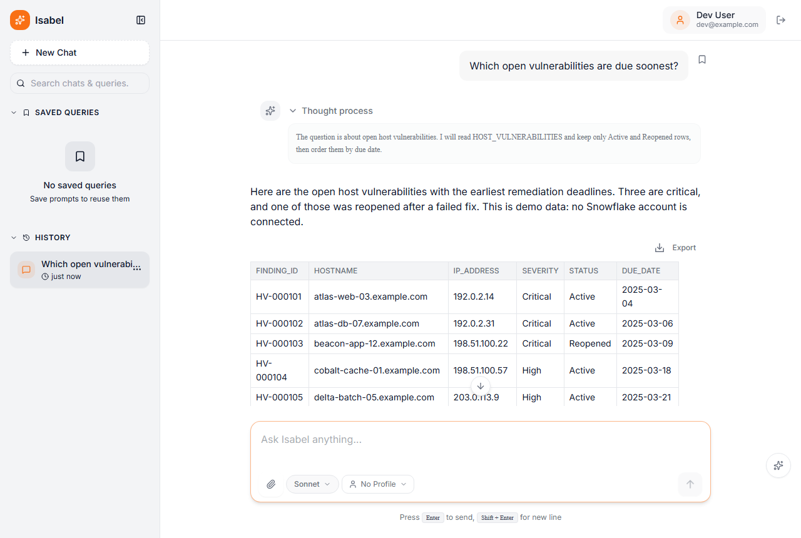

# Isabel

An open-source chat interface for security vulnerability management, built on
[Snowflake Cortex Agents](https://docs.snowflake.com/en/user-guide/snowflake-cortex/cortex-agents).
Ask questions in plain English about hosts, code findings, applications and
teams; Isabel runs the SQL and the search, then answers with text, tables and
charts.



## What it is

Isabel is the application layer around a Cortex Agent: sign-in, group-based
access, streaming answers, conversation history, saved prompts, sharing, file
upload and Excel export. It ships with a synthetic security dataset and three
agents, so you can run the whole thing without your own data.

It is free to run. You pay for the infrastructure you host it on and the
Snowflake credits your questions use.

## Features

- Natural-language questions answered with SQL (Cortex Analyst) and semantic search (Cortex Search)
- Streaming answers with visible reasoning, result tables, Vega-Lite charts and follow-up suggestions
- Azure AD sign-in with group-based authorization that fails closed
- Conversation history, saved queries, shareable conversations, thumbs up or down feedback
- Upload PDF, CSV, DOCX or images as context; export results to Excel
- Model choice between agents (Sonnet, Opus, Haiku) when you configure them
- A service account API for automation, using Azure AD client credentials
- Terraform for ECS Fargate, an ALB, DynamoDB, S3 and Secrets Manager

## Try it in two minutes

No Snowflake or Azure AD account needed. You need Node.js 20+, pnpm and Docker.

```bash
git clone https://github.com/kevinzwu/snowflake-chatbot-isabel.git
cd snowflake-chatbot-isabel
pnpm install
pnpm demo
```

Open http://localhost:3000 and click **Dev Login**. Answers in this mode are
canned, which is enough to explore the interface. To use real data, follow
[docs/snowflake-setup.md](docs/snowflake-setup.md).

## How it works

```
Browser ── Azure AD ──► Next.js on ECS Fargate ──► DynamoDB / S3 (history)
   └── short-lived JWT ──► Snowflake Cortex Agent ──► Analyst (SQL) + Search
```

The server signs a two-minute key-pair JWT for a read-only Snowflake service
user. The browser uses it to stream the agent's answer directly from Snowflake.
See [docs/architecture.md](docs/architecture.md).

## Use it with your own data

1. Create the Snowflake objects and agents. The sample in `examples/` shows the
   structure: tables, a semantic model, a search service and an agent
   specification. [docs/snowflake-setup.md](docs/snowflake-setup.md)
2. Configure the app. [docs/configuration.md](docs/configuration.md)
3. Deploy it. [docs/deployment.md](docs/deployment.md) and
   [deploy/aws/README.md](deploy/aws/README.md)

## Prerequisites

| For              | You need                                                           |
| ---------------- | ------------------------------------------------------------------ |
| Demo mode        | Node.js 20+, pnpm, Docker                                          |
| Real answers     | A Snowflake account with Cortex Agents, Analyst and Search enabled |
| Sign-in          | An Azure AD app registration and groups for your users             |
| Deploying to AWS | An AWS account, Terraform 1.10+, the AWS CLI and Docker            |

## Documentation

| Guide                                      | Covers                                                |
| ------------------------------------------ | ----------------------------------------------------- |
| [Snowflake setup](docs/snowflake-setup.md) | Sample data, agents, key pair, running the example.   |
| [Configuration](docs/configuration.md)     | Every setting and secret, and `bin/secrets.sh`.       |
| [Development](docs/development.md)         | Running locally, tests, conventions, troubleshooting. |
| [Architecture](docs/architecture.md)       | Request flow, components, data, security.             |
| [Deployment](docs/deployment.md)           | Scripts, the image, other platforms.                  |
| [AWS Terraform](deploy/aws/README.md)      | Step-by-step stack setup and teardown.                |
| [API](docs/api.md)                         | Endpoints and the service account API.                |

## Contributing

Issues and pull requests are welcome. Read [CONTRIBUTING.md](CONTRIBUTING.md)
first; contributions need a `Signed-off-by` line (`git commit -s`). Please
report security problems privately, as described in [SECURITY.md](SECURITY.md).
By taking part you agree to the [Code of Conduct](CODE_OF_CONDUCT.md).

## License

Apache License 2.0. See [LICENSE](LICENSE) and [NOTICE](NOTICE).

Isabel is not affiliated with or endorsed by Snowflake, Microsoft or Amazon.
